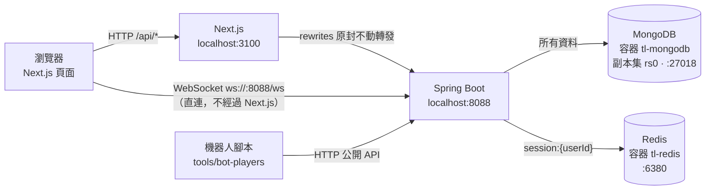
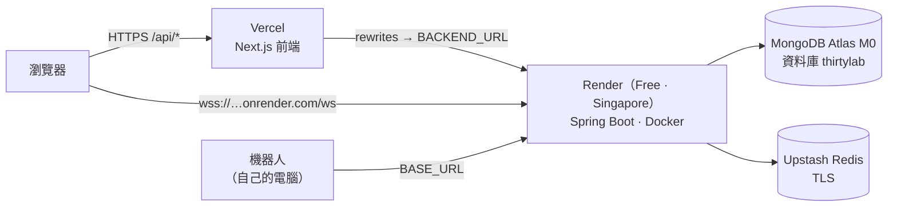
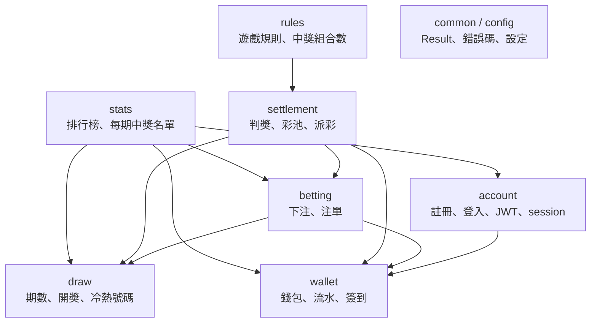
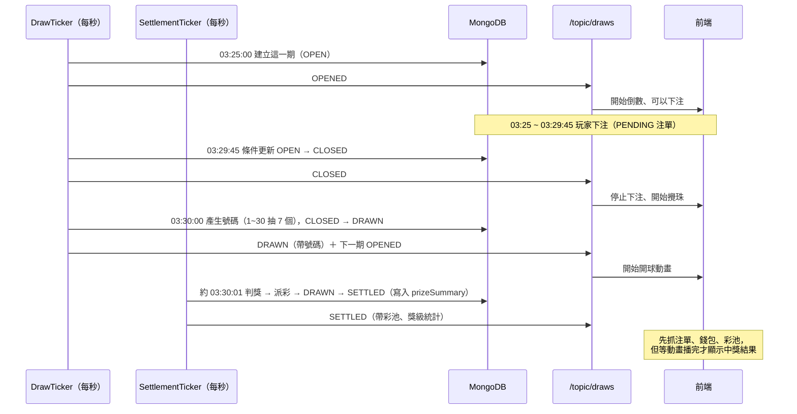
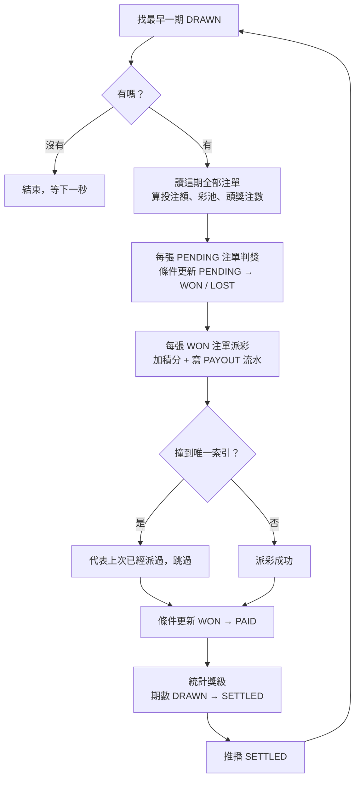
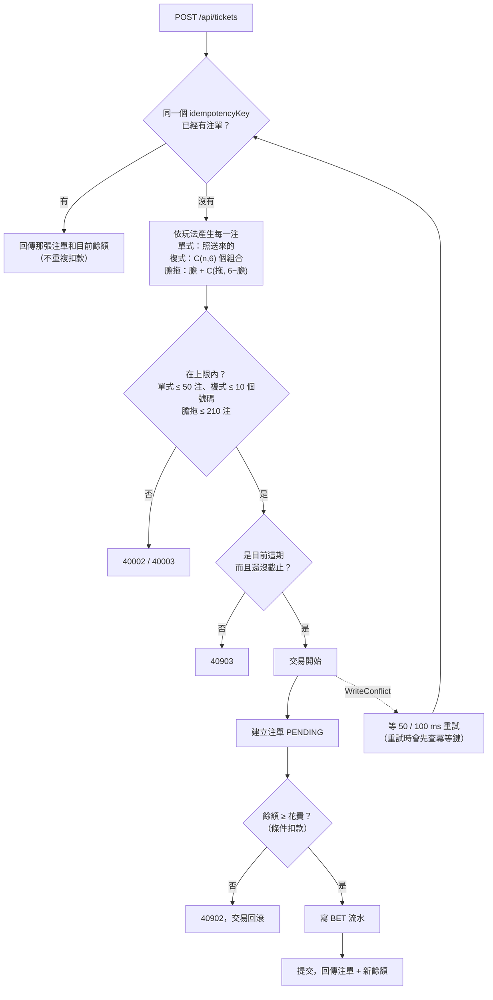
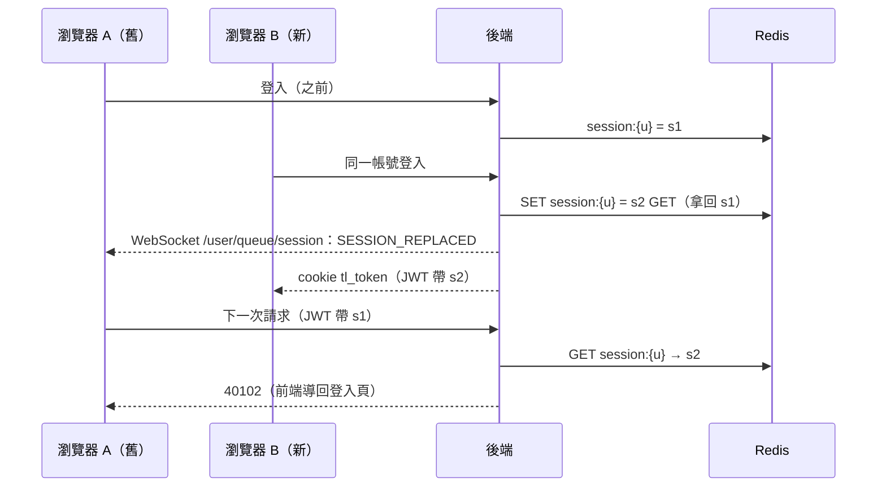
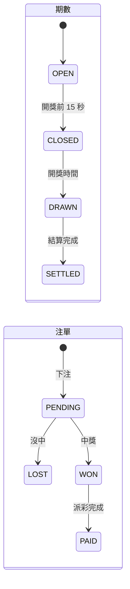
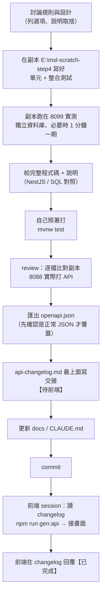

# 專案工作流程：架構、流程圖、總表

30 Lab 每一部分是怎麼運作的。這份是**地圖**：看整體、查「這個功能是哪個 class 做的」。

- 想知道**為什麼這樣寫、每一行在做什麼** → [後端新手教程](backend/README.md)（表格裡的「教程」欄位會直接連到對應的章節）
- Java / Spring 的一般基礎（JVM、集合、並發、JPA、測試、面試題）→ [新手基礎篇](basics/README.md)
- 忘了某個語法 → [速查表](backend-study-notes.md)
- 欄位細節 → [../data-model.md](../data-model.md)；遊戲規則 → [../game-rules.md](../game-rules.md)；上線步驟 → [../deploy.md](../deploy.md)

### 怎麼看這份文件裡的圖

圖是用 Mermaid 畫的，GitHub、VS Code（裝 Markdown Preview Mermaid Support）、IntelliJ 的 Markdown 預覽都會畫出來。看不到圖時，原始碼也讀得懂：

| 圖的種類 | 怎麼讀 |
|---|---|
| `flowchart`（流程圖） | 方框是步驟，菱形是判斷，箭頭是順序。`A --> B` = 做完 A 做 B |
| `sequenceDiagram`（時序圖） | 每一欄是一個參與者（瀏覽器、Controller、資料庫…），**由上往下**是時間順序。實線箭頭是呼叫，虛線箭頭是回傳 |
| `stateDiagram`（狀態圖） | 圓角框是狀態，箭頭是「什麼情況下變成下一個狀態」 |

## 目錄

1. [系統架構（本機）](#1-系統架構本機)
2. [上線架構](#2-上線架構)
3. [後端模組與依賴](#3-後端模組與依賴)
4. [一個 HTTP 請求怎麼走](#4-一個-http-請求怎麼走)
5. [一期的生命週期（每 5 分鐘）](#5-一期的生命週期每-5-分鐘)
6. [業務流程總表](#6-業務流程總表)
7. [重點流程圖](#7-重點流程圖)
8. [背景工作](#8-背景工作)
9. [遊戲設定一覽](#9-遊戲設定一覽)
10. [API 總表](#10-api-總表)
11. [WebSocket 事件](#11-websocket-事件)
12. [資料集合與索引](#12-資料集合與索引)
13. [錯誤碼與驗證規則](#13-錯誤碼與驗證規則)
14. [開發工作流程](#14-開發工作流程)

---

## 1. 系統架構（本機）



| 元件 | 負責 | 怎麼啟動 |
|---|---|---|
| Next.js | 畫面、i18n（錯誤碼翻譯）、3D 開獎動畫；`/api/*` 轉發到後端，同網域所以 cookie 自然帶上 | `cd frontend; npm run dev` |
| Spring Boot | 所有業務規則、排程（開獎、結算）、WebSocket 推播 | IntelliJ 執行 `ThirtyLabBackendApplication` |
| MongoDB（`thirtylab` 資料庫） | 全部資料；設成副本集是為了支援交易 | `docker compose up -d`（Docker 專案 `thirty-lab`） |
| Redis | 每個帳號目前有效的 session id（單一 session 登入） | 同上 |
| 機器人腳本 | 模擬 50~100 個玩家簽到、下注，號碼範圍從 `GET /api/game/rules` 讀 | `node tools/bot-players/bots.mjs` |

本機的 MongoDB、Redis 刻意避開預設埠（27017、6379），因為電腦上另外裝了原生的 MongoDB 和 Redis。

---

## 2. 上線架構

全部用免費方案，步驟在 [../deploy.md](../deploy.md)。



| 跟本機不一樣的地方 | 怎麼處理 |
|---|---|
| 設定 | Render 設 `SPRING_PROFILES_ACTIVE=cloud`，多讀 `application-cloud.properties`（Upstash 走 TLS、日誌降到 INFO） |
| 密碼、連線字串 | 只放在 Render / Vercel 的 Dashboard（環境變數），不進 Git |
| 埠號 | Render 注入 `PORT`，`server.port=${PORT:${SERVER_PORT:8088}}` |
| WebSocket 來源 | `CORS_ALLOWED_ORIGINS` 要設成 Vercel 的網址 |
| 免費方案限制 | Render 15 分鐘沒請求會休眠（機器人開著就不會）；Atlas 512 MB，展示時機器人開 15 個就好 |
| 被踢下線的即時通知 | 失效：cookie 在 Vercel 的網域，WebSocket 連 Render，握手不會帶 cookie。被踢的分頁要等下一次打 API 收到 `40102` |

---

## 3. 後端模組與依賴



- 箭頭 = 「呼叫對方的 Service」；**依賴是單向的**，沒有循環（循環的話 Spring 啟動會失敗，[教程第 3 章](backend/03-spring-bean-di.md)）
- `draw` 不依賴任何業務模組，所以需要「期數 + 注單」的功能放在上層（`settlement`、`stats`）
- 所有模組都會用到 `common`、`config`（圖上省略）
- 規則：**不能用別的模組的 Repository**，也不能 `$lookup` 別的模組的集合（[教程第 8 章](backend/08-mongodb.md#8-模組邊界不能用別人的-repository)）

| 模組 | 主要類別 | 集合 |
|---|---|---|
| account | `AuthController`、`AuthService`、`UserService`、`JwtService`、`SessionService`、`JwtCookieFilter` | `users`；Redis `session:*` |
| wallet | `WalletController`、`WalletService`、`DailyBonusService` | `wallets`、`wallet_transactions` |
| draw | `DrawController`、`DrawService`、`DrawTicker`、`DrawSchedule`、`NumberGenerator`、`NumberStatsService` | `draws` |
| betting | `TicketController`、`BettingService`、`LineExpander`（複式、膽拖展開）、`BallNumber`（自訂驗證） | `tickets` |
| settlement | `JackpotController`、`SettlementService`、`PrizeCalculator`、`SettlementTicker`、`PrizeSummaryBackfill` | （寫 `draws`、`tickets`、錢包，都透過各自的 Service） |
| rules | `GameRulesController`、`GameRulesService`、`Combinations` | — |
| stats | `LeaderboardController`、`LeaderboardService`、`DrawWinnersController`、`DrawWinnersService` | —（讀別人的資料，透過 Service） |
| config | `SecurityConfig`、`WebSocketConfig`、`SchedulingConfig`、`MongoConfig`、`OpenApiConfig`、各種 `*Properties` | — |

---

## 4. 一個 HTTP 請求怎麼走

以「下注」`POST /api/tickets` 為例。逐行講解見 [教程第 5 章](backend/05-first-api.md)（簡單的 GET）和 [第 9 章](backend/09-betting-transactions.md)（下注）。


| 失敗在哪一步 | 回應 | 教程 |
|---|---|---|
| 沒有 cookie / JWT 無效，而路徑要登入 | `40100` | [第 7 章](backend/07-security-login.md) |
| Redis 的 sessionId 不一樣（被別處登入踢掉） | `40102` | [第 7 章](backend/07-security-login.md) |
| `@Valid` 驗證失敗 | `40001` + `[{ field, rule }]` | [第 6 章](backend/06-validation-errors.md) |
| Service 丟 `BusinessException` | 對應錯誤碼（例如 `40902` 積分不足） | [第 6 章](backend/06-validation-errors.md) |
| 沒預期的例外 | `50000`（細節只在後端日誌） | [第 6 章](backend/06-validation-errors.md) |

---

## 5. 一期的生命週期（每 5 分鐘）

以 03:25 開放、03:30 開獎的一期（`20261023-0042`）為例。詳見 [教程第 10 章](backend/10-scheduling-draws.md)、[第 11 章](backend/11-settlement.md)。



| 時間 | 期數狀態 | 誰做的 | 推播 | 前端行為 |
|---|---|---|---|---|
| 開放（每 5 分鐘整點） | `OPEN` | `DrawTicker` | `OPENED` | 倒數、可下注、抓彩池 |
| 開獎前 15 秒 | `CLOSED` | `DrawTicker` | `CLOSED` | 停止下注、攪珠 |
| 開獎時間 | `DRAWN` | `DrawTicker`（`SecureRandom` 洗牌） | `DRAWN` | 開球動畫 |
| 開獎後約 1 秒 | `SETTLED` | `SettlementTicker` | `SETTLED` | 動畫播完才揭曉中獎、更新積分、冷熱號碼、排行榜 |

- 期號 = UTC 日期 + 當天第幾個 5 分鐘：`03:25` → 第 42 個 → `20261023-0042`。一天 288 期
- 伺服器停機再啟動：`DrawTicker` 補做錯過的截止、開獎（停機期間沒建立的期數直接跳過）；`SettlementTicker` **照時間順序**補結算（下一期的彩池要用上一期的滾存）

---

## 6. 業務流程總表

| 流程 | 觸發 | 負責的類別 | 步驟 | 怎麼保證不出錯 | 教程 |
|---|---|---|---|---|---|
| 註冊 | `POST /api/auth/register` | `AuthService` → `WalletService` | 建帳號 → 開錢包 + 送 10,000 → 建 session → 發 cookie | 帳號唯一索引；開戶流水 `SIGNUP_BONUS + userId` 唯一 | [07](backend/07-security-login.md) |
| 登入 | `POST /api/auth/login` | `AuthService`、`SessionService` | 檢查密碼 → Redis `SET...GET` 換新 session → 舊 session 推 `SESSION_REPLACED` → 發 cookie | Redis 原子操作 | [07](backend/07-security-login.md) |
| 被踢下線 | 別處登入同帳號 | `JwtCookieFilter` | 下一次請求 sessionId 對不上 → `40102` | | [07](backend/07-security-login.md) |
| 下注 | `POST /api/tickets` | `BettingService`、`LineExpander` | 冪等鍵查重 → 依玩法產生每一注（複式、膽拖展開）並檢查上限 → 檢查期數 → 交易（建注單 + 扣款 + 流水） | 冪等鍵唯一索引；`balance >= cost` 條件扣款；WriteConflict 重試前先查 | [09](backend/09-betting-transactions.md) |
| 開獎 | 每秒排程 | `DrawTicker` → `DrawService` | 建立 / 截止 / 開獎 | 條件更新（`WHERE status = 舊狀態`）；`drawNo` 唯一索引 | [10](backend/10-scheduling-draws.md) |
| 結算派彩 | 每秒排程 | `SettlementTicker` → `SettlementService` | 判獎 → 派彩 → 標記已派 → 期數 `SETTLED` + 獎級統計 | 每一步可重跑：條件更新 + `PAYOUT + 注單 id` 唯一索引 | [11](backend/11-settlement.md) |
| 頭獎彩池 | `GET /api/jackpot` | `SettlementService` | max(保底 500,000, 上期滾存 + 本期投注額 × 20%) | 跟結算用同一個公式（`PrizeCalculator.jackpotPool`） | [11](backend/11-settlement.md) |
| 每日簽到 | `POST /api/wallet/daily-bonus` | `DailyBonusService` → `WalletService.credit` | 先查今天領過沒 → 加積分 + 流水 | `DAILY_BONUS + userId:日期` 唯一索引；透過代理呼叫才有交易 | [09](backend/09-betting-transactions.md) |
| 冷熱號碼 | `GET /api/draws/number-stats` | `NumberStatsService` | 聚合最近 N 期，補上沒開過的號碼 | 唯讀 | [12](backend/12-aggregation.md) |
| 排行榜 | `GET /api/leaderboard`、`/balance` | `LeaderboardService` | 錢包模組算名次 → 帳戶模組查暱稱 → 投注模組查最近 10 次中獎 | 唯讀；各模組查自己的資料，一次查完避免 N+1 | [12](backend/12-aggregation.md) |
| 每期中獎名單 | `GET /api/draws/{drawNo}/winners` | `DrawWinnersService` | 這期 `PAID` 注單 → 依玩家合併 → 排序 → 查暱稱 | 唯讀 | [12](backend/12-aggregation.md) |
| 補算獎級統計 | 後端啟動 | `PrizeSummaryBackfill` | 找沒有統計的已結算期數 → 用注單重算 → 寫入 | 條件更新（只補沒有的），可重複執行 | [11](backend/11-settlement.md) |
| 遊戲規則 | `GET /api/game/rules` | `GameRulesService` | 讀設定 + 組合數公式 | 跟派彩共用 `PrizeCalculator` | [04](backend/04-configuration.md) |

---

## 7. 重點流程圖

### 7-1. 結算（為什麼當機也不會重複派彩）



任何一步之間當機：期數還是 `DRAWN`，下一秒重跑，已完成的步驟因為條件不符或撞到唯一索引而自動跳過。

### 7-2. 下注



在這之前，`@Valid` 已經檢查過格式：號碼 1 ~ `maxNumber`、不重複；單式每注 6 個、複式至少 7 個、膽拖 1~5 個膽且膽 + 拖至少 7 個；每種玩法只能填自己的欄位（不合格回 `40001`）。

複式、膽拖展開之後，跟單式一樣是一注一注的 `lines`，所以後面的扣款、結算、統計都不用分玩法。

### 7-3. 登入與單一 session



### 7-4. 狀態機



每一個箭頭都是一個**條件更新**：只有目前在箭頭起點的狀態，才會被改成終點的狀態。所以重複執行不會出錯。

---

## 8. 背景工作

| 類別 | 頻率 | 做什麼 | 開關 |
|---|---|---|---|
| `DrawTicker` | 每秒（`fixedDelay = 1000`） | 建立目前這期、到時間就截止、開獎；推播 `OPENED` / `CLOSED` / `DRAWN` | `app.scheduling.enabled` |
| `SettlementTicker` | 每秒 | 把所有 `DRAWN` 的期數照時間順序結算；推播 `SETTLED` | 同上 |
| `PrizeSummaryBackfill` | 啟動時一次（`ApplicationRunner`） | 補算舊期數的獎級統計 | 同上 |

- 排程用專屬的執行緒池（`SchedulingConfig`，2 條執行緒），兩個 ticker 互不阻擋
- 測試的 profile 把開關設成 `false`，這三個都不會執行

---

## 9. 遊戲設定一覽

全部在 `backend/src/main/resources/application.properties`，改了重啟後端就生效，**不用改程式**。前端從 `GET /api/game/rules` 讀，不寫死。

| 設定 | 目前的值 | 意思 |
|---|---|---|
| `app.game.max-number` | `30` | 號碼 1~30（最少 7、最多 99，啟動時檢查） |
| `app.game.draw-interval` | `5m` | 每 5 分鐘一期 |
| `app.game.betting-cutoff` | `15s` | 開獎前 15 秒截止 |
| `app.game.points-per-bet` | `10` | 每注 10 積分 |
| `app.betting.max-lines` | `50` | 單式：一張注單最多 50 注 |
| `app.betting.max-multiple-numbers` | `10` | 複式：最多 10 個號碼（210 注） |
| `app.betting.max-banker-lines` | `210` | 膽拖：展開後最多 210 注（膽固定 1~5 個） |
| `app.wallet.signup-bonus` | `10000` | 註冊送 10,000 |
| `app.wallet.daily-bonus` | `1000` | 每日簽到 1,000（每個 UTC 日一次） |
| `app.prize.jackpot-floor` | `500000` | 頭獎彩池保底 |
| `app.prize.jackpot-rate-percent` | `20` | 每期投注額的 20% 注入彩池 |
| `app.prize.second` ~ `seventh` | 56,000 / 6,400 / 800 / 160 / 80 / 20 | 二～七獎固定獎金 |

30 球的中獎機率：頭獎 1 / 593,775、任何獎約 1 / 13.3。完整的獎級表見 [../game-rules.md](../game-rules.md)。

> 測試用的設定（`src/test/resources/application-test.properties`）固定成 49 球和舊獎金，跟這裡分開。調整遊戲平衡只改這裡，測試不受影響。

---

## 10. API 總表

| 方法 | 路徑 | 登入 | 模組 | 說明 |
|---|---|---|---|---|
| POST | `/api/auth/register` | 不用 | account | 註冊（成功即登入，送 10,000） |
| POST | `/api/auth/login` | 不用 | account | 登入（踢掉同帳號的舊 session） |
| POST | `/api/auth/logout` | 不用 | account | 登出 |
| GET | `/api/auth/me` | 要 | account | 目前使用者 |
| GET | `/api/wallet` | 要 | wallet | 餘額 |
| GET | `/api/wallet/transactions` | 要 | wallet | 積分流水（分頁） |
| GET | `/api/wallet/daily-bonus` | 要 | wallet | 今天簽到了沒 |
| POST | `/api/wallet/daily-bonus` | 要 | wallet | 簽到（`40904` 已領過） |
| GET | `/api/draws/current` | 不用 | draw | 目前這期 + 上一期結果 |
| GET | `/api/draws` | 不用 | draw | 開獎紀錄（分頁，含 `prizeSummary`） |
| GET | `/api/draws/number-stats` | 不用 | draw | 冷熱號碼（`window` 1~500，固定 `maxNumber` 筆） |
| GET | `/api/draws/{drawNo}/winners` | 不用 | stats | 這期中獎名單（最多 50 人） |
| POST | `/api/tickets` | 要 | betting | 下注（`betType`：`SINGLE` 填 `lines`、`MULTIPLE` 填 `numbers`、`BANKER` 填 `bankers` + `legs`） |
| GET | `/api/tickets` | 要 | betting | 我的注單（分頁） |
| GET | `/api/jackpot` | 不用 | settlement | 本期頭獎彩池（估計） |
| GET | `/api/leaderboard?period=DAY\|WEEK` | 不用 | stats | 中獎榜（前 20 + 自己 + 最近 10 次中獎） |
| GET | `/api/leaderboard/balance` | 不用 | stats | 富豪榜（只列下注過的人） |
| GET | `/api/game/rules` | 不用 | rules | 遊戲規則：球數、各玩法上限、獎級、中獎組合數、彩池規則 |

「不用登入」的路徑都在 `SecurityConfig` 的 `permitAll` 清單裡；有登入時會多回傳自己的資料（例如排行榜的 `mine`、中獎名單的 `me`）。完整格式見 [../api/openapi.json](../api/openapi.json) 或 Swagger（http://localhost:8088/swagger-ui.html）。

---

## 11. WebSocket 事件

| 目的地 | `type` | 何時 | 內容 | 前端要做什麼 |
|---|---|---|---|---|
| `/topic/draws` | `OPENED` | 新的一期開放 | `draw`（時間） | 更新期數、倒數 |
| | `CLOSED` | 截止下注 | `draw` | 停止下注、攪珠 |
| | `DRAWN` | 開獎 | `draw`（含號碼） | 開球動畫 |
| | `SETTLED` | 結算完成 | `draw`（含 `poolAmount`、`prizeSummary`） | 抓注單、錢包、彩池；**動畫播完才顯示** |
| `/user/queue/session` | `SESSION_REPLACED` | 同帳號在別處登入 | — | 當成登出、導回登入頁（不要呼叫 logout） |

每則 `/topic/draws` 訊息都帶 `serverTime`。後端重啟時可能一次補送好幾期，前端要用 `drawNo` 對應。詳見 [教程第 13 章](backend/13-websocket.md)。

---

## 12. 資料集合與索引

資料庫：本機 `thirtylab`、測試 `thirtylab_test`、上線 Atlas 的 `thirtylab`。

| 集合 | 一筆代表 | 重要欄位 | 索引 |
|---|---|---|---|
| `users` | 一個帳號 | `username`、`passwordHash`、`nickname` | `username` 唯一 |
| `wallets` | 一個人的錢包 | `userId`、`balance` | `userId` 唯一 |
| `wallet_transactions` | 一筆積分變動 | `type`、`amount`、`balanceAfter`、`refId` | `type + refId` 唯一、`userId + createdAt`、`type + createdAt` |
| `tickets` | 一張注單（多注） | `lines`、`cost`、`status`、`results`、`payout` | `userId + idempotencyKey` 唯一、`userId + createdAt`、`drawNo + status`、`userId + status + settledAt` |
| `draws` | 一期 | `drawNo`、`status`、時間、`numbers`、`specialNumber`、`poolAmount`、`jackpotRollover`、`prizeSummary` | `drawNo` 唯一、`drawAt` |

- 流水的 `type`：`SIGNUP_BONUS`（`refId` = userId）、`DAILY_BONUS`（`userId:日期`）、`BET` / `PAYOUT`（注單 id）
- 索引在啟動時依照 model 上的 `@Indexed` / `@CompoundIndex` 自動建立
- 每份文件都有 Spring Data 加的 `_class`（完整的 Java 類別名稱），所以**上線後不要隨便改 package 名稱**（[教程第 8 章](backend/08-mongodb.md)）

---

## 13. 錯誤碼與驗證規則

### 錯誤碼（`common/ErrorCode.java`）

| code | HTTP | 意思 |
|---|---|---|
| `40000` | 400 | 請求錯誤（通用，例如 JSON 格式錯誤、`betType` 不是已知的值） |
| `40001` | 400 | 欄位格式不符（`data: [{ field, rule }]`） |
| `40002` | 400 | 注數超過上限（單式超過 50 注、膽拖展開超過 210 注） |
| `40003` | 400 | 複式號碼超過上限（超過 10 個） |
| `40100` | 401 | 請先登入 |
| `40101` | 401 | 帳號或密碼錯誤 |
| `40102` | 401 | 帳號已在其他地方登入 |
| `40300` | 403 | 沒有權限 |
| `40400` | 404 | 資源不存在 |
| `40901` | 409 | 帳號已被使用 |
| `40902` | 409 | 積分不足 |
| `40903` | 409 | 這一期已截止下注 |
| `40904` | 409 | 今天已經簽到過了 |
| `50000` | 500 | 系統繁忙 |

### `40001` 的 `rule`

| rule | 來自 | 例子 |
|---|---|---|
| `notNull` / `notBlank` / `notEmpty` | `@NotNull` / `@NotBlank` / `@NotEmpty` | 沒填 |
| `size` | `@Size` | 密碼少於 8 個字、一注不是 6 個號碼、複式少於 7 個、膽不是 1~5 個 |
| `pattern` | `@Pattern` | 帳號有不允許的字元 |
| `ballNumber` | `@BallNumber`（自訂） | 號碼不在 1 ~ `maxNumber` |
| `assertTrue` | `@AssertTrue` | 看 `field`：`numbersDistinct` 號碼重複（膽拖是膽和拖合起來）；`selectionMatchesBetType` 欄位跟玩法不符；`legsEnough` 膽 + 拖不到 7 個 |
| `typeMismatch` | 網址參數轉型失敗 | `?page=abc`、`?period=YEAR` |

前端依 `code` 和 `rule` 翻譯；`msg` 只是給開發看的。

---

## 14. 開發工作流程

### 一個後端功能從討論到交接



- **副本**（`E:\msl-scratch-step4`）是後端程式碼的另一份複製，用來先試做、先跑測試，確認可行才教。跑在 8099、用 `thirtylab_scratch` 資料庫，不會碰到正式資料
- 前端、後端在**不同的 Claude Code 對話**裡開發，靠 `docs/api-changelog.md` 交接

### 前後端協作

| 誰 | 做什麼 | 檔案 |
|---|---|---|
| 後端 | Swagger 註解（`@Operation`、`@Schema`，必填欄位標 `REQUIRED`） | Controller、DTO |
| 後端 | 匯出契約 | `docs/api/openapi.json` |
| 後端 | 寫交接：改了什麼、前端要做什麼 | `docs/api-changelog.md`（最上面） |
| 前端 | 重新產生 TS 型別 | `npm run gen:api` |
| 前端 | 錯誤碼翻譯、畫面 | `frontend/` |
| 雙方 | 需要對方配合的事 | changelog 標【待前端】/【待後端】→【已完成】 |

### 改了遊戲規則或資料格式時

例如 2026-10-23 號碼從 1~49 改成 1~30：

1. 改設定（`app.game.max-number`）和程式
2. 測試的設定**不跟著改**（測試固定用 49 球）
3. 前端改成讀 `rules.maxNumber`
4. 舊資料不相容（舊的期數有大於 30 的號碼）→ **停掉後端和機器人 → 刪除資料庫和 Redis 的 session → 重啟**，所有帳號重新註冊

**只調獎金**（例如 2026-10-23 頭獎保底改成 500,000、二～七獎改成 56,000 / 6,400 / 800 / 160 / 80 / 20，讓七獎 = 注金 2 倍，回收率約 74%）就簡單得多：

1. 只改 `application.properties` 的 `app.prize.*`，重啟後端
2. 不用改程式、不用改測試（測試有自己固定的獎金）、**不用清資料**：已經結算的期數保留當時的金額，新的期數用新的金額
3. 前端從 `GET /api/game/rules` 讀，自動跟著變；只有前端寫死的預設值（`features/draw/rules.ts`）要一起改
4. 更新 `docs/game-rules.md` 的獎金表，在 `api-changelog.md` 記一筆

### 常用指令

```powershell
docker compose up -d                          # MongoDB（tl-mongodb）+ Redis（tl-redis）
docker compose down                           # 停止（資料保留在 volume）
cd backend; .\mvnw.cmd spring-boot:run        # 後端（或 IntelliJ 執行 ThirtyLabBackendApplication）
cd backend; .\mvnw.cmd test                   # 全部測試（用 thirtylab_test，不會碰真實資料）
cd backend; .\mvnw.cmd clean test             # 改過 package、刪過檔案後用這個
cd frontend; npm run dev                      # 前端
node tools/bot-players/bots.mjs               # 機器人玩家（$env:BOT_COUNT=20 可以少開一點）
docker exec -it tl-mongodb mongosh --port 27018   # 直接查資料庫
docker exec tl-redis redis-cli keys "session:*"   # 看目前有誰登入
```

匯出 API 契約（後端在跑的時候）：

```powershell
curl http://localhost:8088/v3/api-docs -o docs/api/openapi.json
```
