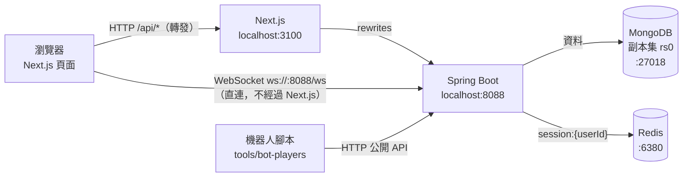
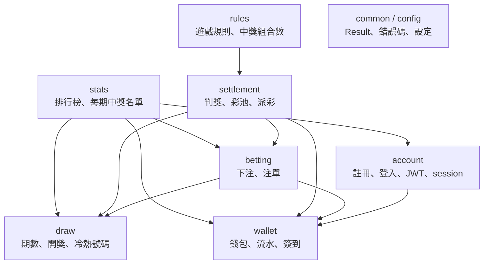
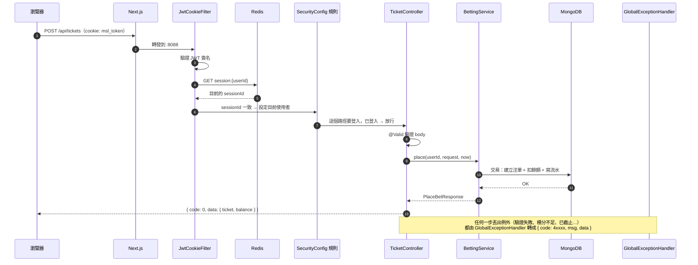
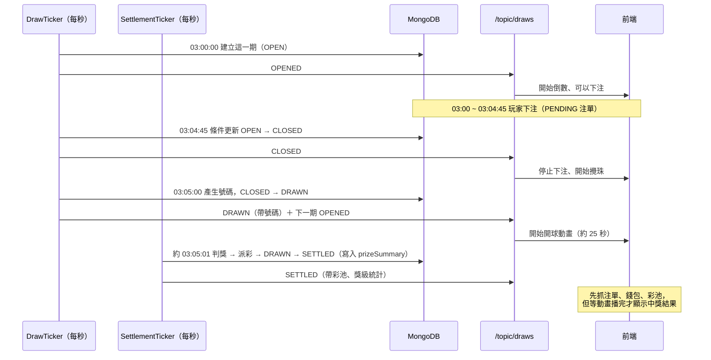
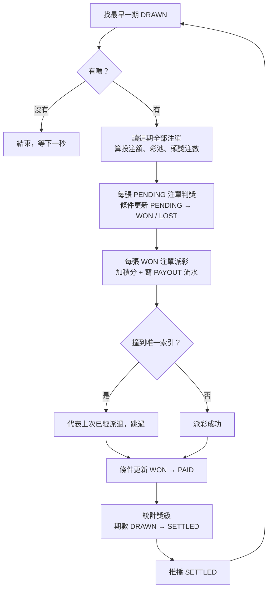
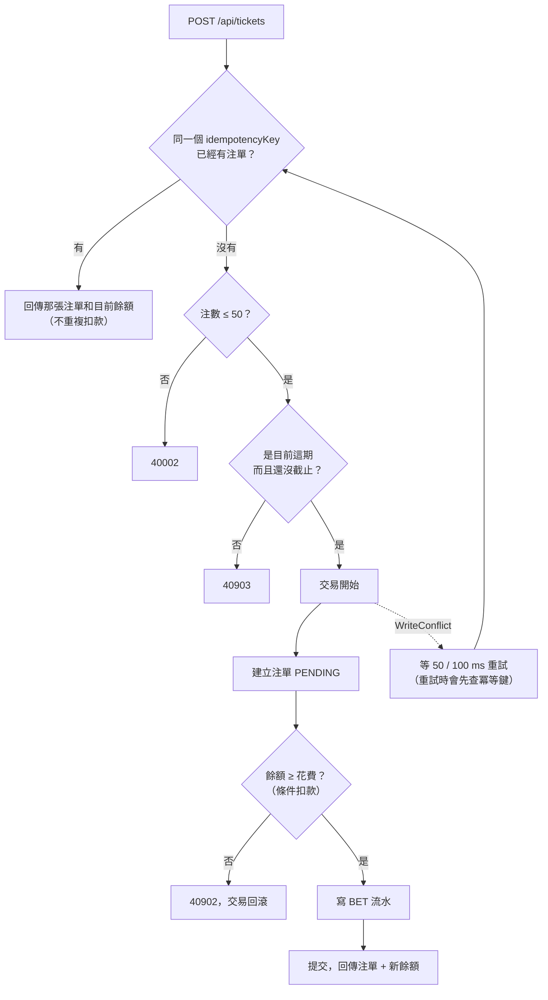
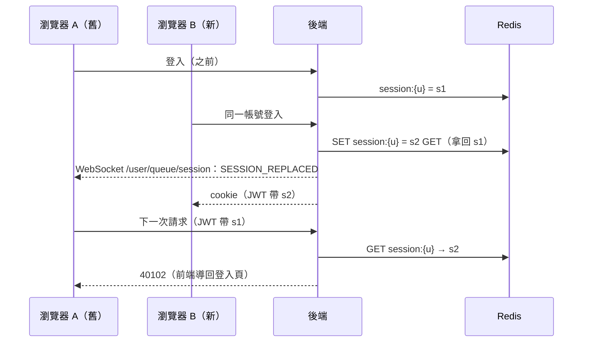
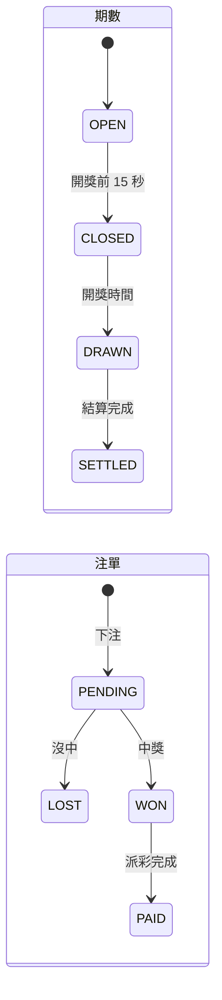
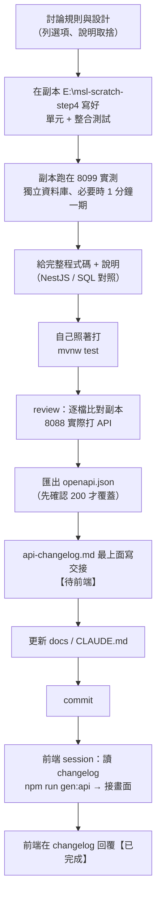

# 專案工作流程：架構、流程圖、總表

Mark Six Lab 每一部分是怎麼運作的。圖用 Mermaid 畫，GitHub、VS Code（裝 Markdown Preview Mermaid Support）、IntelliJ 的 Markdown 預覽都看得到。

原理和語法說明見 [backend-study-notes.md](backend-study-notes.md)；欄位細節見 [../data-model.md](../data-model.md)；狀態機見 [../state-machines.md](../state-machines.md)。

## 目錄

1. [系統架構](#1-系統架構)
2. [後端模組與依賴](#2-後端模組與依賴)
3. [一個 HTTP 請求怎麼走](#3-一個-http-請求怎麼走)
4. [一期的生命週期（每 5 分鐘）](#4-一期的生命週期每-5-分鐘)
5. [業務流程總表](#5-業務流程總表)
6. [重點流程圖](#6-重點流程圖)
7. [背景工作](#7-背景工作)
8. [API 總表](#8-api-總表)
9. [WebSocket 事件](#9-websocket-事件)
10. [資料集合與索引](#10-資料集合與索引)
11. [錯誤碼](#11-錯誤碼)
12. [開發工作流程](#12-開發工作流程)

---

## 1. 系統架構



| 元件 | 負責 |
|---|---|
| Next.js | 畫面、i18n（錯誤碼翻譯）、3D 開獎動畫；`/api/*` 轉發到後端，同網域所以 cookie 自然帶上 |
| Spring Boot | 所有業務規則、排程（開獎、結算）、WebSocket 推播 |
| MongoDB | 全部資料；副本集是為了支援交易 |
| Redis | 目前每個帳號的 session id（單一 session 登入） |
| 機器人腳本 | 模擬 50~100 個玩家簽到、下注 |

---

## 2. 後端模組與依賴



- 箭頭 = 「呼叫對方的 Service」；**依賴是單向的**，沒有循環
- `draw` 不依賴任何業務模組，所以需要「期數 + 注單」的功能放在上層（`settlement`、`stats`）
- 所有模組都會用到 `common`、`config`（圖上省略）

| 模組 | 主要類別 | 集合 |
|---|---|---|
| account | `AuthController`、`AuthService`、`UserService`、`JwtService`、`SessionService`、`JwtCookieFilter` | `users`；Redis `session:*` |
| wallet | `WalletController`、`WalletService`、`DailyBonusService` | `wallets`、`wallet_transactions` |
| draw | `DrawController`、`DrawService`、`DrawTicker`、`DrawSchedule`、`NumberGenerator`、`NumberStatsService` | `draws` |
| betting | `TicketController`、`BettingService` | `tickets` |
| settlement | `JackpotController`、`SettlementService`、`PrizeCalculator`、`SettlementTicker`、`PrizeSummaryBackfill` | （寫 `draws`、`tickets`、錢包，透過各自的 Service） |
| rules | `GameRulesController`、`GameRulesService`、`Combinations` | — |
| stats | `LeaderboardController`、`LeaderboardService`、`DrawWinnersController`、`DrawWinnersService` | —（讀別人的資料，透過 Service） |

---

## 3. 一個 HTTP 請求怎麼走

以「下注」`POST /api/tickets` 為例：



| 失敗在哪一步 | 回應 |
|---|---|
| 沒有 cookie / JWT 無效，而路徑要登入 | `40100` |
| Redis 的 sessionId 不一樣（被別處登入踢掉） | `40102` |
| `@Valid` 驗證失敗 | `40001` + `[{ field, rule }]` |
| Service 丟 `BusinessException` | 對應錯誤碼（例如 `40902` 積分不足） |
| 沒預期的例外 | `50000` |

---

## 4. 一期的生命週期（每 5 分鐘）

以 03:00 開放、03:05 開獎的一期為例：



| 時間 | 期數狀態 | 誰做的 | 推播 | 前端行為 |
|---|---|---|---|---|
| 開放（每 5 分鐘整點） | `OPEN` | `DrawTicker` | `OPENED` | 倒數、可下注、抓彩池 |
| 開獎前 15 秒 | `CLOSED` | `DrawTicker` | `CLOSED` | 停止下注、攪珠 |
| 開獎時間 | `DRAWN` | `DrawTicker`（`SecureRandom` 洗牌） | `DRAWN` | 開球動畫 |
| 開獎後約 1 秒 | `SETTLED` | `SettlementTicker` | `SETTLED` | 動畫播完才揭曉中獎、更新積分、冷熱號碼、排行榜 |

伺服器停機再啟動：`DrawTicker` 補做錯過的截止、開獎；`SettlementTicker` **照時間順序**補結算（因為下一期的彩池要用上一期的滾存）。

---

## 5. 業務流程總表

| 流程 | 觸發 | 負責的類別 | 步驟 | 怎麼保證不出錯 |
|---|---|---|---|---|
| 註冊 | `POST /api/auth/register` | `AuthService` → `WalletService` | 建帳號 → 開錢包 + 送 10,000 → 建 session → 發 cookie | 帳號唯一索引；開戶流水 `SIGNUP_BONUS + userId` 唯一 |
| 登入 | `POST /api/auth/login` | `AuthService`、`SessionService` | 檢查密碼 → Redis `SET...GET` 換新 session → 舊 session 推 `SESSION_REPLACED` → 發 cookie | Redis 原子操作 |
| 被踢下線 | 別處登入同帳號 | `JwtCookieFilter` | 下一次請求 sessionId 對不上 → `40102` | |
| 下注 | `POST /api/tickets` | `BettingService` | 冪等鍵查重 → 檢查期數是否開放 → 交易（建注單 + 扣款 + 流水） | 冪等鍵唯一索引；`balance >= cost` 條件扣款；WriteConflict 重試 |
| 開獎 | 每秒排程 | `DrawTicker` → `DrawService` | 建立 / 截止 / 開獎 | 條件更新（`WHERE status = 舊狀態`） |
| 結算派彩 | 每秒排程 | `SettlementTicker` → `SettlementService` | 判獎 → 派彩 → 標記已派 → 期數 `SETTLED` + 獎級統計 | 每一步可重跑：條件更新 + `PAYOUT + 注單 id` 唯一索引 |
| 頭獎彩池 | `GET /api/jackpot` | `SettlementService` | 上期滾存 + 本期投注額 × 20%，至少 1,000,000 | 跟結算用同一個公式 |
| 每日簽到 | `POST /api/wallet/daily-bonus` | `DailyBonusService` → `WalletService.credit` | 先查今天領過沒 → 加積分 + 流水 | `DAILY_BONUS + userId:日期` 唯一索引；透過代理呼叫才有交易 |
| 冷熱號碼 | `GET /api/draws/number-stats` | `NumberStatsService` | 聚合最近 N 期 | 唯讀 |
| 排行榜 | `GET /api/leaderboard`、`/balance` | `LeaderboardService` | 錢包模組算名次 → 帳戶模組查暱稱 → 投注模組查最近 10 次中獎 | 唯讀；模組各自查自己的資料 |
| 每期中獎名單 | `GET /api/draws/{drawNo}/winners` | `DrawWinnersService` | 這期 `PAID` 注單 → 依玩家合併 → 排序 → 查暱稱 | 唯讀 |
| 補算獎級統計 | 後端啟動 | `PrizeSummaryBackfill` | 找沒有統計的已結算期數 → 用注單重算 → 寫入 | 條件更新（只補沒有的），可重複執行 |
| 遊戲規則 | `GET /api/game/rules` | `GameRulesService` | 讀設定 + 組合數公式 | 跟派彩共用 `PrizeCalculator` |

---

## 6. 重點流程圖

### 6-1. 結算（為什麼當機也不會重複派彩）



任何一步之間當機：期數還是 `DRAWN`，下一秒重跑，已完成的步驟因為條件不符或撞到唯一索引而自動跳過。

### 6-2. 下注



### 6-3. 登入與單一 session



### 6-4. 狀態機



---

## 7. 背景工作

| 類別 | 頻率 | 做什麼 | 開關 |
|---|---|---|---|
| `DrawTicker` | 每秒（`fixedDelay = 1000`） | 建立目前這期、到時間就截止、開獎；推播 `OPENED` / `CLOSED` / `DRAWN` | `app.scheduling.enabled` |
| `SettlementTicker` | 每秒 | 把所有 `DRAWN` 的期數照時間順序結算；推播 `SETTLED` | 同上 |
| `PrizeSummaryBackfill` | 啟動時一次 | 補算舊期數的獎級統計 | 同上 |

- 排程用專屬的執行緒池（`SchedulingConfig`，2 條執行緒），兩個 ticker 互不阻擋
- 測試的 profile 把開關設成 `false`，這三個都不會執行

---

## 8. API 總表

| 方法 | 路徑 | 登入 | 模組 | 說明 |
|---|---|---|---|---|
| POST | `/api/auth/register` | 不用 | account | 註冊（成功即登入，送 10,000） |
| POST | `/api/auth/login` | 不用 | account | 登入（踢掉同帳號的舊 session） |
| POST | `/api/auth/logout` | 不用 | account | 登出 |
| GET | `/api/auth/me` | 要 | account | 目前使用者 |
| GET | `/api/wallet` | 要 | wallet | 餘額 |
| GET | `/api/wallet/transactions` | 要 | wallet | 積分流水（分頁） |
| GET | `/api/wallet/daily-bonus` | 要 | wallet | 今天簽到了沒 |
| POST | `/api/wallet/daily-bonus` | 要 | wallet | 簽到（`40904` 已領過） |
| GET | `/api/draws/current` | 不用 | draw | 目前這期 + 上一期結果 |
| GET | `/api/draws` | 不用 | draw | 開獎紀錄（分頁，含 `prizeSummary`） |
| GET | `/api/draws/number-stats` | 不用 | draw | 冷熱號碼（`window` 1~500） |
| GET | `/api/draws/{drawNo}/winners` | 不用 | stats | 這期中獎名單（最多 50 人） |
| POST | `/api/tickets` | 要 | betting | 下注 |
| GET | `/api/tickets` | 要 | betting | 我的注單（分頁） |
| GET | `/api/jackpot` | 不用 | settlement | 本期頭獎彩池（估計） |
| GET | `/api/leaderboard?period=DAY\|WEEK` | 不用 | stats | 中獎榜（前 20 + 自己 + 最近 10 次中獎） |
| GET | `/api/leaderboard/balance` | 不用 | stats | 富豪榜（只列下注過的人） |
| GET | `/api/game/rules` | 不用 | rules | 遊戲規則、獎級、中獎組合數 |

「不用登入」的路徑都在 `SecurityConfig` 的 `permitAll` 清單裡；有登入時會多回傳自己的資料（例如排行榜的 `mine`）。完整格式見 [../api/openapi.json](../api/openapi.json) 或 Swagger。

---

## 9. WebSocket 事件

| 目的地 | `type` | 何時 | 內容 | 前端要做什麼 |
|---|---|---|---|---|
| `/topic/draws` | `OPENED` | 新的一期開放 | `draw`（時間） | 更新期數、倒數 |
| | `CLOSED` | 截止下注 | `draw` | 停止下注、攪珠 |
| | `DRAWN` | 開獎 | `draw`（含號碼） | 開球動畫 |
| | `SETTLED` | 結算完成 | `draw`（含 `poolAmount`、`prizeSummary`） | 抓注單、錢包、彩池；**動畫播完才顯示** |
| `/user/queue/session` | `SESSION_REPLACED` | 同帳號在別處登入 | — | 當成登出、導回登入頁（不要呼叫 logout） |

每則 `/topic/draws` 訊息都帶 `serverTime`。後端重啟時可能一次補送好幾期，前端要用 `drawNo` 對應。

---

## 10. 資料集合與索引

| 集合 | 一筆代表 | 重要欄位 | 索引 |
|---|---|---|---|
| `users` | 一個帳號 | `username`、`passwordHash`、`nickname` | `username` 唯一 |
| `wallets` | 一個人的錢包 | `userId`、`balance` | `userId` 唯一 |
| `wallet_transactions` | 一筆積分變動 | `type`、`amount`、`balanceAfter`、`refId` | `type + refId` 唯一、`userId + createdAt`、`type + createdAt` |
| `tickets` | 一張注單（多注） | `lines`、`cost`、`status`、`results`、`payout` | `userId + idempotencyKey` 唯一、`userId + createdAt`、`drawNo + status`、`userId + status + settledAt` |
| `draws` | 一期 | `drawNo`、`status`、時間、`numbers`、`specialNumber`、`poolAmount`、`jackpotRollover`、`prizeSummary` | `drawNo` 唯一、`drawAt` |

流水的 `type`：`SIGNUP_BONUS`（`refId` = userId）、`DAILY_BONUS`（`userId:日期`）、`BET` / `PAYOUT`（注單 id）。

---

## 11. 錯誤碼

| code | HTTP | 意思 |
|---|---|---|
| `40000` | 400 | 請求錯誤（通用） |
| `40001` | 400 | 欄位格式不符（`data: [{ field, rule }]`） |
| `40002` | 400 | 注數超過上限 |
| `40100` | 401 | 請先登入 |
| `40101` | 401 | 帳號或密碼錯誤 |
| `40102` | 401 | 帳號已在其他地方登入 |
| `40300` | 403 | 沒有權限 |
| `40400` | 404 | 資源不存在 |
| `40901` | 409 | 帳號已被使用 |
| `40902` | 409 | 積分不足 |
| `40903` | 409 | 這一期已截止下注 |
| `40904` | 409 | 今天已經簽到過了 |
| `50000` | 500 | 系統繁忙 |

---

## 12. 開發工作流程

### 一個後端功能從討論到交接



### 前後端協作
| 誰 | 做什麼 | 檔案 |
|---|---|---|
| 後端 | Swagger 註解（`@Operation`、`@Schema`，必填欄位標 `REQUIRED`） | Controller、DTO |
| 後端 | 匯出契約 | `docs/api/openapi.json` |
| 後端 | 寫交接：改了什麼、前端要做什麼 | `docs/api-changelog.md`（最上面） |
| 前端 | 重新產生 TS 型別 | `npm run gen:api` |
| 前端 | 錯誤碼翻譯、畫面 | `frontend/` |
| 雙方 | 需要對方配合的事 | changelog 標【待前端】/【待後端】→【已完成】 |

### 常用指令
```powershell
docker compose up -d                          # MongoDB + Redis
cd backend; .\mvnw.cmd spring-boot:run        # 後端（或 IntelliJ 執行）
cd backend; .\mvnw.cmd test                   # 全部測試（用 marksixlab_test，不會碰真實資料）
cd frontend; npm run dev                      # 前端
node tools/bot-players/bots.mjs               # 機器人玩家
```
