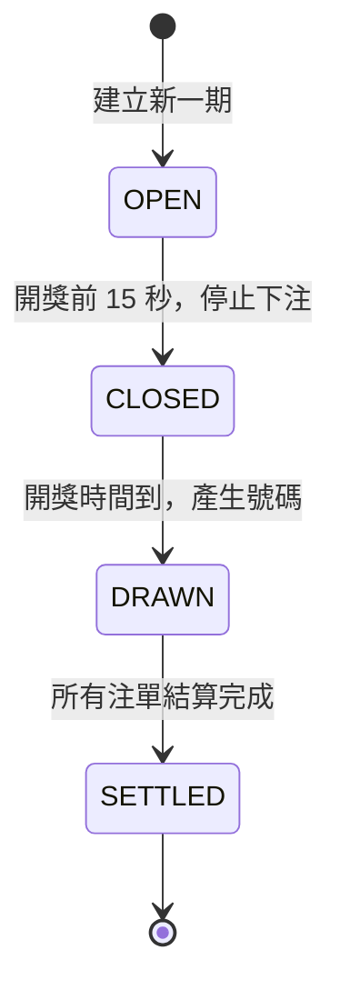
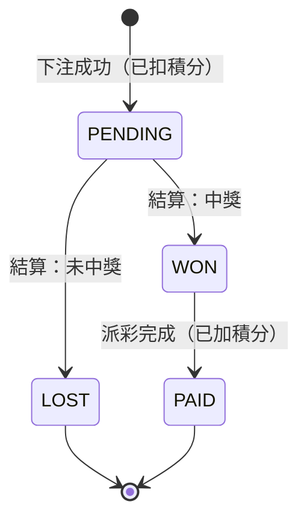

# 狀態機

狀態只能按箭頭方向前進。每次狀態變更都用「條件更新」（例如 `status = OPEN` 才能改成 `CLOSED`），防止並發或重跑時跳錯狀態。

## 期數（draw）

| 狀態 | 含義 | 允許的操作 |
|---|---|---|
| `OPEN` | 開放下注 | 下注 |
| `CLOSED` | 停止下注，等待開獎 | 無 |
| `DRAWN` | 已開獎，結算中 | 查詢開獎結果 |
| `SETTLED` | 已結算 | 查詢開獎結果、中獎明細 |

## 注單（ticket）

- `WON → PAID` 分開兩步，派彩失敗時可以只重跑派彩，不用重新判獎。
- 派彩的積分流水用 `type + refId` 唯一索引，保證同一張注單只派一次。

**草稿**：階段 0 確定資料模型時一起定稿。
